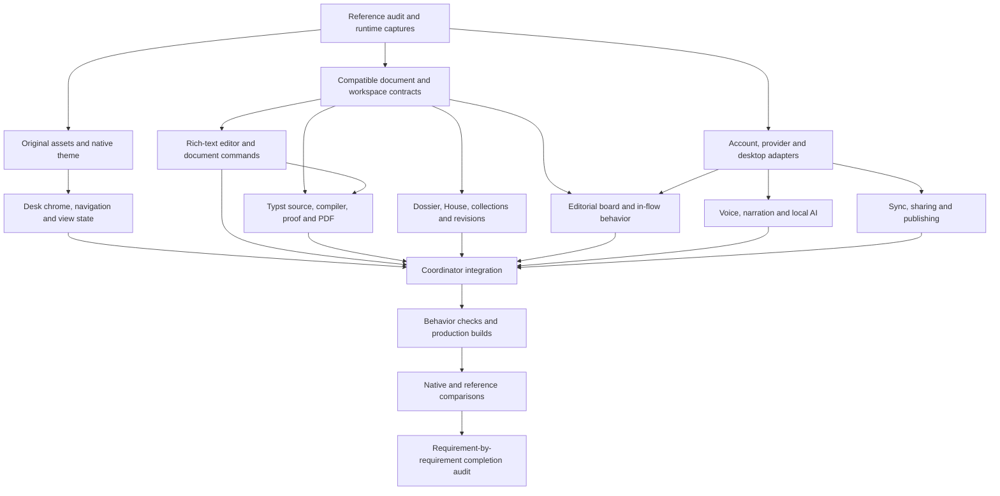

# Twyne desktop port

The target is the existing Twyne desktop experience rendered with GPUI. The
reference is `desktop/main.ts`, which opens the full hosted application in
Electrobun at 1280 × 860. Matching the reference includes its styling, original
assets, interaction states, documents, and connected workflows.

The current offline editor and independent foundations are partial delivery.
The full styling, asset and behavior port remains unfinished; scoped checks do
not establish completion of the desktop experience.

## Requirements and evidence

| Requirement                                                                                           | Authoritative source                                                                                            | Completion evidence                                                                                        | Current state                                                                                                                                                                                   |
| ----------------------------------------------------------------------------------------------------- | --------------------------------------------------------------------------------------------------------------- | ---------------------------------------------------------------------------------------------------------- | ----------------------------------------------------------------------------------------------------------------------------------------------------------------------------------------------- |
| Original palette, theme presets, typography, icons, portraits, textures and artwork                   | `src/global.css`, `src/utils/theme.ts`, `src/utils/icon-system.ts`, `src/assets`, `public/assets`               | Original asset provenance plus rendered comparisons for every supported theme                              | In progress                                                                                                                                                                                     |
| Matching window and navigation: masthead, drawer, Home/House/library/settings, account and file menus | `desktop/main.ts`, `src/routes`, `src/components/auth`, `src/components/folio`                                  | Same route transitions, labels, keyboard/focus behavior and screenshots at matching sizes                  | In progress                                                                                                                                                                                     |
| Matching quiet default, compositor, Write/Source/Proof/Split, Zen and persistent view choices         | `src/utils/editor-view-preferences.ts`, `src/components/editor/typst-workspace.*`, `compositor-panel.tsx`       | Default and expanded-state screenshots; actual mode transitions preserve text, selection and source drafts | In progress                                                                                                                                                                                     |
| Compatible Folio, dossier, House, collections, revisions, notes and document exchange                 | `src/types`, `src/utils/idb.ts`, `exchange.ts`, `folio-export.ts`, `house-model.ts`, `revision-history.ts`      | Web-produced backups round trip without field loss; folio switches retain scoped state                     | Web exchange, offline Dossier, local House/collections and native revisions implemented; full connected compatibility in progress                                                               |
| Rich-text editing and all compositor commands, objects, layout, headers, notes and drag/drop          | `src/components/editor/twyne-editor.tsx`, extensions, `compositor-panel.tsx`, `src/utils/typography-options.ts` | Real native editing/IME/clipboard/undo tests and equivalent document rendering                             | Native rich editor/compositor in progress; typography, object geometry and drag/drop parity remain                                                                                              |
| Canonical Typst source, recovery, Apply/Discard, conflict handling, real proof and PDF export         | `src/utils/typst`, `typst-workspace.tsx`, `typst-source-ribbon.tsx`                                             | Real compiler, rendered pages, PDF text/artwork and recoverable reload checks                              | Native compile/recovery/Apply implemented; source UI and error presentation parity remain                                                                                                       |
| Cast, Rubric, Marginalia, Apparatus, Tools and Versions with matching state retention                 | `board-tabs.ts`, `editorial-board-overlay.tsx`, panel components and background services                        | Working panel actions, original assets, background/unread behavior and comparison screenshots              | Local Cast, retained Rubric, Apparatus/citation placement, Versions, writer Marginalia and Tools implemented with scoped checks; full panel styling and connected behavior pending              |
| Dossier form/conversation/refinement, contextual amendments and in-flow writing behavior              | `src/components/onboarding`, `src/routes/dossier`, `src/components/in-flow`, `src/utils/flow-*`                 | Same creation/refinement and return-to-writing workflows with retained authorship/context                  | Offline form/create/refine and local Flow implemented; conversation repair/host proposal active, mounted lifecycle/filing and connected amendments/gathering pending                            |
| Account identity, settings, sync, sharing/collaboration, writer-owned publishing                      | Current auth/Convex/ATProto client contracts                                                                    | Actual authorized account, sync/conflict, shared-role and publishing flows; mocks alone are insufficient   | Account outbox/CAS/conflict and collaboration preparation exported with 26/9 library checks; mounted UI, native client registration, trusted auth transport and connected backend flows pending |
| AI providers, local LiteRT process lifecycle, editor/rubric/research requests and errors              | `desktop/litert-server.ts`, `src/utils/ai-client.ts`, background services, settings                             | Actual configured providers and local process shutdown/readiness checks                                    | Exported routing/stream/freshness foundation passes 16 corrected library checks; mounted requests, actual providers and local-model readiness/process proof pending                             |
| Narration, speech transport, Live voice desk and spoken notes/interview                               | `src/utils/speech.ts`, `src/components/ui/live-voice-desk.*`, speech transport                                  | Native audio/device and provider checks, including pause/seek/cancel/error recovery                        | Optional `native-audio` foundation passes 18 synthetic Rust checks and 6 Source-backed Bun checks / 109 assertions; mounted voice, real devices and provider transport pending                  |
| Desktop build, packaging, updates and OS integrations                                                 | Existing desktop build configuration and GPUI platform APIs                                                     | Clean builds and native runtime/file-picker/keyboard checks on target operating systems                    | Linux runtime receipts and reviewed 47-file/3-executable staging integrity retained; current-source release, relocation, installers, signing, updates and other-OS runtime pending              |

No row may be marked complete from a narrower test or a plausible-looking
placeholder. Existing green storage tests prove storage behavior, not feature
or visual parity.

## Execution graph



## Ownership and waves

| Wave | Deliverables and ownership                                                                                                                                          | Acceptance gate                                                                        |
| ---- | ------------------------------------------------------------------------------------------------------------------------------------------------------------------- | -------------------------------------------------------------------------------------- |
| 0    | Coordinator: current-state audit, reference server/browser fixtures, this plan                                                                                      | Source and rendered reference are available; pre-existing dirty work remains protected |
| 1    | Asset worker: `src/theme.rs`, `src/assets.rs`, `assets/**`, asset sync tool. Contract explorer: read-only source inventory. Coordinator: app/view-state integration | Exact source provenance and compatible foundations                                     |
| 2    | Document foundation and independent feature modules after contracts are fixed; central `app.rs`, `main.rs`, manifests and existing web files stay coordinator-owned | Relevant feature behavior is implemented with focused checks                           |
| 3    | Coordinator integrates native routes, editor, document, panel and adapter slices                                                                                    | No orphaned controls, fake successful operations, or incompatible document paths       |
| 4    | Checks/builds, then real runtime comparisons across default, expanded, narrow, theme and error states                                                               | Static, behavioral and rendered evidence covers each requirement                       |
| 5    | Full audit above                                                                                                                                                    | All requested behavior and appearance is true and verified                             |

Workers must use disjoint file ownership, accommodate concurrent edits, and
preserve pre-existing work. Local fixture behavior, live provider behavior,
account integration, OS/runtime checks and release evidence are recorded
separately.

## Verification

Use the Devenv toolchain for Rust checks and builds. Preserve the source app;
native fixtures and browser fixtures use isolated local libraries and origins.

```bash
rtk proxy devenv shell -- rtk proxy bun run desktop.gpui.check
rtk proxy devenv shell -- rtk proxy bun run desktop.gpui.test
rtk proxy devenv shell -- rtk proxy bun run desktop.gpui.test-ui
rtk proxy devenv shell -- rtk proxy cargo clippy --locked --all-targets --features ui-tests --manifest-path desktop/gpui/Cargo.toml -- -D warnings
rtk proxy devenv shell -- rtk proxy bun run desktop.gpui.build
```

Compare reference and native windows at 1280 × 860 and at narrower widths,
using the same documents, fonts, theme, route, tool state and panel state.
Capture the quiet default, expanded compositor, open drawer, each board tab,
source draft, proof/split view, dossier, House, library, settings, account/error
states and Live voice. Exercise document exchange and reload, selection and
undo, source recovery, real PDF, providers and authorized connected workflows.

These are verification commands, not a record of a fresh aggregate run. The
active goal remains open until the full audit passes.

## Current evidence

The feature ownership, original counterparts, and focused investigation commands
are indexed in [ARCHITECTURE.md](ARCHITECTURE.md). Room composition, title/body
coordination, slash coordination, and host tests now live in `src/app/` modules;
`app.rs` remains the active-document host and still needs coherent extraction.

The earlier October 5 title/insertion checkpoint has [recorded acceptance](fixtures/insert-menu/native-acceptance.json):
115 mounted desktop tests, 8 pure insertion tests, strict UI Clippy, the actual
17-command/21-query Source catalog check, and three browser interaction cases
pass. Actual native-font captures at 948 × 640 show a fully visible three-line
centered title on the body’s scrolling page, the unfiltered/filtered slash menu,
and its then-current table form. This is historical feature evidence. The
parameter checkpoint below supersedes its query-cancellation and hint behavior;
the native Link command and viewport clamping remain documented differences.
The refreshed normal preview uses the existing library separately from capture
fixtures. This checkpoint does not establish connected workflows or full parity.

The current [parameter checkpoint](fixtures/insert-menu/parameter-acceptance.json)
records 118 mounted desktop tests, 10 pure insertion tests, a pure code-block
exit/undo check, strict UI Clippy, and 27 executed original table helper vectors.
Five original-browser parameter cases pass with no page errors. The native
8 × 10 table picker inserts keyboard/pointer dimensions with a header row;
parameter activation removes the query before opening, and Cancel leaves that
removal intact. Retained targets reject changed manuscripts, editors, revisions
and carets. Registry hint labels and rich structural keybindings are mounted;
Mod-Enter exits a code block before falling through to page-break insertion.

Three actual-native captures use an immutable current build, original font
faces, rich import fixtures and isolated libraries at 948 × 640 / scale 1.
The original table box is 245.90625 × 249.265625; native flex rounding currently
produces 246 × 246 with 18-pixel cells. Caption weight, initial grid focus and
original time-based undo grouping remain comparison work. Note/Mermaid modal
styling, diagram preview, immediate blank equation insertion and the inline image
URL bar remain implementation work. Prototype text manuscripts do not yet bind
the rich structural shortcuts. This checkpoint compares insertion surfaces;
the capture defaults do not establish full-room or title parity.

A bounded [Sakana modal review](fixtures/insert-menu/advisory-modal/adoption-review.json)
retains its frozen inputs and root corrections. Missing host context produced
several false findings; no product code was adopted from that review. The normal
user preview remains on its prior title/insertion build with its library intact.

Retained receipts apply to their recorded inputs and scope. The latest foundations
are exported but not mounted connected workflows:

| Scope                     | Retained evidence                                                                                                                                                                 | Boundary                                                                                                           |
| ------------------------- | --------------------------------------------------------------------------------------------------------------------------------------------------------------------------------- | ------------------------------------------------------------------------------------------------------------------ |
| Account and collaboration | [26 account checks](fixtures/account-sync/integration-gates.json), [9 collaboration checks](fixtures/native-collaboration/integration-gates.json), strict UI Clippy checkpoint    | Local contracts/persistence and request preparation; no authenticated transport or mounted sync/sharing/publishing |
| AI                        | [16 corrected library checks](fixtures/native-ai/runtime-review/integration-gates.json)                                                                                           | Captured routing, streaming and freshness; no provider call, model readiness or mounted UI                         |
| Audio                     | [18 synthetic Rust checks](fixtures/native-audio/integration-gates.json), 6 Source-backed Bun checks / 109 assertions                                                             | Optional `native-audio`, mock PCM/lifecycle and source corpus; no devices, provider or mounted controls            |
| Wayland clipboard         | [29 native checks](fixtures/wayland-clipboard/native-acceptance.json), [8 ordinary-app checks](fixtures/wayland-clipboard/ordinary-app-acceptance.json)                           | Actual private Sway; no all-compositor, all-OS or clipboard-manager claim                                          |
| Pagination and Apparatus  | [8 physical-page/input checks](fixtures/pagination/native-acceptance.json), [16 assembled Apparatus checks](fixtures/host-apparatus/native-acceptance-pagination-integrated.json) | Actual isolated X11; current web route does not register its existing pagination engine                            |
| Distribution              | [47 actual staged files / 3 ELF executables](fixtures/distribution/parent-gates.json)                                                                                             | Integrity only; older release app, Nix-store helper loaders, no current release/runtime/install/portability proof  |

Receipts retain input/log hashes and local artifact paths. They do not establish
a fresh aggregate suite, CI result, default rebuild or distributable release.

- Original assets are embedded with source provenance, licenses, and lossless
  artwork conversion. Native captures use the source-derived font faces rather
  than GPUI's synthetic test font. The writing UI uses deterministic upright
  and italic 400/700 instances of the original Lora 3.008 variables, under the
  licensed internal alias `Twyne Body`; authored `Lora` attributes stay intact.
  Regular and italic 400 advances and outlines match the original Google
  responses for the measured shared glyphs. A separate DM Sans 600/opsz12
  instance supplies the small buttons. Bold outlines, optical sizes beyond
  that button face, and remaining shaping/raster differences remain explicit
  limits. Original font bytes and Typst loading order are unchanged.
  The footer uses the original DM Sans400/opsz11 instance, and File's
  disclosure uses the actual Noto Sans Math fallback face. Chromium's
  menu-list arrow is reproduced from its original native path. At620px,
  the Pages/count-one controls measure51px/71px in both runtimes; fractional
  footer positions and raster differences still require comparison. An
  intrinsic-spacer experiment increased the discrepancy and was removed.
  Appearance presets/overrides persist with actual
  save acknowledgements and OS-following System mode. Settings sections beyond
  Appearance and full interface comparisons across themes remain. Thirteen
  original CSS paper-grain fixtures pass against actual native WGPU pixels,
  including custom colors, clipping and scroll phase. Repeated frames do no
  raster/tint work, and an overlay above real controls preserves their layout,
  clicks, typing and focus. Opaque House/Library roots retain the source's flat
  fill rather than exposing the body texture.
- Actual web-generated backups exercise unknown fields, absent/null values,
  brief data, cached HTML, canonical source, and byte-preserving Typst export.
  Source and projected rich HTML remain distinct at every save boundary.
- Native input checks cover Unicode, IME/clipboard, stored formatting, typing
  undo groups, atomic source objects, and source-preserving offline images.
  Real captures exposed and corrected heading-width and opening-initial flow
  errors. Remaining typography/object differences are recorded separately.
  Earlier dictionary-enabled notebook comparisons used injected static UI
  faces. Fresh comparisons now use the original app's Google responses and
  corrected native instances; those layout differences are being rechecked.
  The earlier evidence does not establish current interface pixel parity.
  A source-exact75.6px medium illuminated initial and its CSS box/margins now
  restore the original wide Notebook remem-/ber break. Narrow row text remains
  unchanged. Contiguous text now retains one fractional measurement plan for
  layout, paint, input and drag. Actual Notebook captures at704/554px match H2
  tops within.082px and the final paragraph within.088px. All35 rich-view gates
  and nine OS drag checks pass after the fix, including a raw-width wrap
  threshold that previously produced excess scroll space. Nested opaque block
  rounding, heading tracking/shaping and platform raster differences remain;
  painted baseline offsets have not been used to hide them.
  Thirteen current Google-font URL and punctuation cases now match the
  original row text. Display-only shaping boundaries retain slash kerning
  without entering authored text, selection, clipboard, IME, or history.
  This is a bounded line-wrap check; English discretionary hyphenation and
  remaining paragraph-flow differences are still separate.
- Rich clipboard metadata preserves marks, notes, source atoms, and image
  attributes inside the native process, including Unicode replacement and one
  undo transaction. Actual isolated X11 processes exchange HTML, UTF-8 text and
  native metadata, including large incremental transfers. Mounted native
  Paste/Copy/Undo/Redo actions pass, and late clipboard ownership, focus,
  selection, read-only and editor changes reject stale candidates. All 15
  isolated transport/action checks pass, including 2,640,026-byte INCR in both
  directions and rejection above the original 5 MB canonical-source limit
  before insertion. [X11 acceptance](fixtures/editor/clipboard-interoperability.md)
  records that transport scope. RTF-only input and unsupported deep ProseMirror
  contexts are rejected. Integrated Wayland transfer passes the retained private
  Sway runs above, including actual keyboard-press serials, offers, stale-candidate
  refusal, Cut/undo and clean shutdown. Other compositors, macOS/Windows external
  rich transport and clipboard-manager exit handover remain unverified.
- The local image picker adapter is exercised through actual native controls:
  success/export/undo, cancellation, invalid bytes, and stale insertion points
  preserve the manuscript. The importer compares eight real browser-produced
  data URLs and metadata. Valid files that exceed the original 5 MB canonical
  editing limit are rejected before live text, selection, or undo history changes.
  Rotated JPEG pixels match GPUI decode; animated WebP
  and APNG display remain static even though all original bytes are retained.
  These checks do not establish a real OS portal dialog or device result.
- Ruler drag/keyboard changes save folio margins and respect Read mode. The
  continuous page uses original guides and border geometry; it invents no page
  count. The optional native single-column pagination engine has physical-sheet,
  page-gap, later-page input/hit-testing, selection, undo/redo and resize evidence
  in the retained X11 receipt. This is separate from the current web route,
  which registers `PageBreakNode` but not its existing pagination engine.
  Full route/raster parity, columns, unsupported structures and scheduler timing
  remain explicit limits in the [pagination contract](fixtures/pagination/README.md).
- The native compiler uses the same Typst fork revision and ordered fonts as
  web WASM. Retained rendered comparisons cover two web-produced fixture pages
  at equal raster size, and extracted PDF text matched. PDF encoding/metadata differ;
  this evidence does not establish browser Write rendering parity.
- The actual GPUI Source/Proof test compiles a valid manuscript, rejects invalid
  edits while retaining the last valid proof and recoverable source draft, and
  applies corrected source only after a successful current compile/save.
- The offline Dossier uses the original form/defaults/starter functions, scoped
  recovery, actual persistence acknowledgement, and revision-guarded filing.
  Conversation repair and a host integration proposal are active; isolated
  module/type checks do not establish aggregate, rendered or live filing behavior.
  Connected conversation and provider actions remain capability-gated.
- LaTeX uses the original MathJax proof SVG. The web Write view uses KaTeX;
  that geometry gap remains. The built `twyne-math-write` helper is diagnostic
  only: `CurrentSource` refuses the observed KaTeX engine/CSS mismatch, rather
  than treating diagnostic geometry as Write parity. The scoped CSS/Mermaid
  proposal remains unapplied; a real NodeView fixture is active. Packaged native
  rendering, paragraph integration and actual GPU geometry remain pending in the
  [math contract](fixtures/math-write/README.md).
- House and Library use actual local context records, original field and preview
  semantics, scoped filing, and a shared ledger. Unblurred input survives
  navigation and closing; failed metadata writes retain the working form and
  expose retry. Source-only imports are retained rather than assigned cached
  HTML previews or invented counts. Connected archive/export engine actions and
  full route/account parity remain.
- Focused native rich-input events drive the original bounded rhythm sampler;
  whole-document word counts run only at session boundaries. The original
  classifier traces and spool geometry have browser fixtures. Real native input
  tests cover automatic focus without moving the page, Escape/manual overrides,
  Source/Read exclusion, visibility, metadata failure/retry, and late save joins.
  The Tools pane publishes automatic-focus preferences after actual disk
  acknowledgement. AI review, live margin tools, cover lookup, amendments and
  connected flow cards remain capability-gated or absent.
  Actual Drawer scrolling and opening reaches those local controls; keyboard
  activation, durable preference acknowledgement and failed-write rollback
  remain covered by the same mounted interaction check. The masthead and
  compositor retain focus through the two-sidebar wrapping state, and Undo/
  Redo use actual rich history. Original-font captures still expose a few
  Board/paragraph spacing differences. The footer follows the original
  control order and narrow-window visibility rules; isolated native captures
  accept an explicit viewport size for responsive comparison.
  A real native X11 driver passes20 focus/selector checks on both one-page and
  three-page proofs: pointer focus has
  no keyboard outline, keyboard navigation paints the original2px inset
  outline, disabled Pages cannot focus, and selected page/count options retain
  the original mode behavior. Initial legacy-HTML conversion retains the
  imported HTML and metadata; subsequent navigation preserves exact saved
  bytes. A separate mounted real-compiler check covers multi-page top
  alignment, mode retention, invalid-proof retention and count shrinkage.
  The shared Tab primitive now exposes the same provided focus handle to
  rendering, accessibility, observation and keyboard dispatch. These checks
  cover the desk buttons, compositor tabs, Zen and the page selector. Closed
  Arrow/Home/End/PageUp/PageDown selection retains native focus and follows
  the original mode behavior. Mounted and actual X11 checks observe native
  value and expanded properties on the existing button root; the popup's
  actual open state supplies expanded. A13-page browser check confirms the
  three-option PageUp/PageDown step and restores Source exactly. Seventeen
  recorded browser typeahead steps and two timeout cases drive native bounded
  label search. Actual X11 input verifies repeated-letter cycling, a prefix
  containing Space without opening the popup, expiry, idle Space opening the
  popup and Escape retaining focus. Search performs no document reads.
  Non-ASCII search folding, other controls and assistive-technology parity remain.
- Marginalia uses original folio/comment IDs, preserved unknown metadata, and
  durable request/acknowledgement writes. Eleven coordinator/inline checks drive
  actual native selection, final unblurred Unicode input, marked-passage
  navigation, one-step mark undo, shared Board/inline replies, folio retention,
  metadata failure/retry, canonical manuscript failure before metadata filing,
  scoped orphan reconciliation after the accepted manuscript save, and
  missing-body mark erasure without modifying foreign-scope metadata.
  Placement saves the manuscript mark before requesting note metadata; a
  failure keeps the exact note candidate and reply input. Source-only folios
  do not invent anchor knowledge. The core store and mounted panel checks are
  separate from these coordinator checks. Unplaced note drafts remain
  session-only, and the two storage files are not globally crash-atomic.
  Integrated checks also cover transient preview dismissal/recall, same-scope
  thread opening, Zen/read-only exclusion, and an admitted rail thread following
  Dock reflow without losing its reply. Page/text bounds are checked against
  the actual native elements, and the full outer thread height is reserved.
  Dragging hides the thread and retains the same reply input. Passage hover
  routing is integrated; its scoped native interaction checks remain separate.
  Twelve scoped rail checks and actual native captures confirm the corrected
  outer-top stripe and retained wrapping. The remaining overall1px preview
  offset is recorded. Original browser hover/dismiss checks preserve saved
  HTML and comment/reply/unknown metadata. Board/thread geometry differences,
  remaining rail states, connected persona replies and voice still remain.
- Versions uses real durable checkpoints, source-aware passage comparisons,
  task statuses, and request/acknowledgement UI. Restore retains a durable
  pre-restore snapshot and compares current input/source generation before
  the library CAS. Web comparison fixtures match; native histories are not
  represented as Lix-compatible. Narrow confirmation reveal/focus is tested.
- One retained Cast view now serves Board, Room of Editors and Full Analysis.
  Three coordinator checks cover final-character capture, per-folio recovery,
  route-save joins and actual failed-write retry/late-ACK rejection. Nine actual
  isolated X11 checks pass through real Reply/New/Cancel, metadata write
  obstruction/retry, Analysis/Back, File only and focused Ctrl-Q. The final
  unblurred draft reaches disk, the process exits cleanly, and canonical
  manuscript bytes plus foreign raw metadata remain exact. A narrow vendored
  GPUI X11 destructor patch releases the active input handler before entity
  teardown. Four independent actual X11 close checks pass for focused Cast
  Textarea and Source Editor through both Ctrl-Q and WM_DELETE_WINDOW; those
  Cast/Source close paths on other platforms remain separately unverified.
  Provider, voice, analytics and
  persona-mark capabilities stay unavailable. Fresh1280/620px captures use
  corrected capsule pills and the original raw glyph fonts. Manager assistance
  outer geometry matches at1280px; first-card text remains about4px taller,
  and620px action/assistance wraps still differ. These host checks do not
  establish visual parity.
- The packaged local helper matches six original Chrome Rubric context
  observations, including exact source HTML projection/SHA256, the499/500-word
  threshold and static measurements, four retained-room explanation cases,
  and signed/fractional local dates. Packaged-helper comparisons retain these
  original results alongside the document, proof and Apparatus checks.
  The retained model passes11 checks and the host coordinator passes seven
  mounted checks for scoped route/shutdown retention and folio changes,
  actual write failure / retry / stale-ACK rejection, joining a background
  candidate exactly once, and freshness after explicit Save or metadata ACK
  during unsaved typing. The actual X11 Board/Galley driver passes ten checks,
  including typed weights, failed-write retry, explicit custom Add/Remove,
  retained unsubmitted forms and final unblurred Ctrl-Q with a clean exit.
  Original/final manuscript bytes and saved editorial artifacts remain exact.
  Full Board/report visual comparison remains in progress.
  Static measurements do not substitute for editorial grades. Draft context
  runs on the background executor at opening or settled-save boundaries;
  native input invalidates it with constant work.
- Apparatus shares a retained exact-scope model between the Board and full
  page. Twelve model, nine mounted view and ten host cases cover source
  building, stale scan refusal, global citation style, foreign raw metadata,
  acknowledgement-based source mutations, held failure/retry and scoped copy.
  Explicit citation placement resolves the original text anchor, commits a
  single native note history step, then saves the manuscript before filing its
  metadata timestamp. An immediately submitted citation captures pending note
  text and keeps that edit in a separate undo step. Failed timestamp writes
  retain the placed note and retry metadata without duplicating the citation.
  The actual isolated X11 driver passes sixteen checks, including scoped external
  clipboard exchange, steering, unblurred note Save, kind conversion and history,
  blocked departure/retry and clean Ctrl-Q.
  Formatting refresh disables old-context requests; disappearing controls
  restore the nearest surviving focus scope, with a real Ctrl-S regression.
  These retained assembled checks predate the newest unmounted library exports;
  they do not establish a fresh aggregate suite or default build. Retained native
  wide/narrow captures cover both surfaces with the same marked Notebook and
  retained metadata. Remaining visual differences are recorded in the fixture
  README; full pixel parity remains in progress. Twenty Board and twenty
  Page ASCII URL cases match unchanged browser line sequences using the actual
  bundled Linux font, with explicit quantization and Unicode/raster limits.
  Code-block citation placement, paragraph splitting and table-ending trailing
  paragraphs still have known Source differences. Offline steering uses the
  original failure guards; account/provider research and previews remain pending.
- Inline notes have retained text/kind controls, previous/reference/next/delete,
  collected endnotes and footnotes, and guarded navigation back to the actual
  manuscript atom. Save, route changes and citation preparation flush unblurred
  input. Nine note checks, three mounted citation checks and four mounted host
  save/navigation checks pass after the bounded paint/field corrections. A
  reproduced queued-event regression now keeps an accepted note revision clean
  while later edits still become dirty. Actual X11 verifies the focused note
  Save state separately. Original parser whitespace and
  research-text projections have separate source-backed corpora. Insertion and
  hover animation, vertical textarea resizing, original/native popup raster
  comparison and screen-reader announcement remain separate gaps.
- Source uses GPUI Kit's native code editor with the original Typst syntax
  rules and snippets. Ordinary syntax edits reparse only the affected line
  unless a block comment changes later lexical state. Unicode snippet,
  undo/redo, search, navigation and separate recovery checks pass; final
  Source screenshots and all-current integration gates remain in progress.
  Source comment/snippet undo and redo restore the actual native caret and
  selected Unicode text, including mixed-indent comments and CRLF mapping.
  The original Noto Sans Mono regular and semibold faces, with Chromium's
  synthetic comment oblique, are embedded for Source alone. Mounted checks
  select the actual faces and retain source bytes, read-only selection, and
  measured caret positions in the CJK/heading/comment fixtures. This does not
  establish matching antialiasing or platform emoji/Hangul fallback.
  Four actual resize widths (1280/640/320/160) preserve real marker ranges,
  helper rows, caret/IME bounds, read-only unfolding and source history. The
  exact generated marker receives its verified hyphen break; ordinary and
  unfolded printable-ASCII rows now use an optional cached actual-font CSS
  wrapping policy. All126 executed browser rows match across six widths;
  16 scoped native/GPU gates preserve bytes, selection, IME, history and
  resize behavior. None/Unicode/tab/control/inline-metric fallback stays
  upstream. The21 remaining unsupported-row differences and raster limits
  remain explicit. Linux Source also
  retains the original Ctrl+Shift+Z alias alongside Ctrl+Y.
- Source opening and edits schedule the actual Typst compiler after the
  original 450 ms pause. A real mounted compiler check proves that leaving
  Source cancels the scheduled work, invalid drafts retain the last valid
  proof, corrected proof text remains a draft until Apply, and Discard restores
  a proof of canonical source. Generated helpers fold the closing body marker;
  native line navigation reveals it without changing source or undo history.
  These scoped checks do not establish full UI, operating-system or connected-flow
  parity, or a current aggregate suite.

Build and runtime receipts apply to their recorded local inputs. Cross-platform
workflow configuration and metadata scaffolds do not prove CI, a runnable macOS
bundle, Windows runtime, clean installation, signing, audio devices, providers or
authenticated connected workflows. Dossier lifecycle/filing, real math NodeViews,
full visual parity and mounted account/AI/audio/collaboration remain unfinished.

## Reviewed equation host, inline child and Dossier stamp checkpoint

The actual writing room now installs a folio/visit-qualified equation source form for inline and block atoms. Submit runs the existing canonical converter against a copied current manuscript; accepted commands use the real editor history and Save pipeline. The measured inline child reserves one source scalar in its paragraph, sharing caret, selection/IME and neighboring baseline geometry. Route changes retire the current form. The original Special Elite reviewed-count stamp now uses prepared original outlines, rotation and Source box dimensions.

Root's current local checkpoint passes 678 checks (563 library, 97 application, 18 audio contracts), with eight hardware checks ignored. All-target Clippy denies warnings and passes. See `fixtures/math-write/parent-inline-stamp-gates.json` for the exact tested inputs/logs. Broader gates caught and repaired unsupported equation hit-target interception and block-drag propagation; the old draft-switch fixture now follows the real Dossier Cancel route.

Native X11 equation input/save/history and refreshed Dossier interactions are separate active gates. Browser inline first-baseline/intrinsic sizing, current KaTeX geometry/preview, vertical textarea resizing, paper descendant multiply, renderer epoch retirement and full visual parity remain unfinished. Unmounted connected foundations and release/platform proof also remain open.

## Writing-tool integration evidence (2026-10-05)

The four original writing tools are now mounted in the native editor. The
[writing-tool notes](fixtures/gen-ui/README.md) record retained inputs, editor
replacement/Undo, durable Keep/Jot acknowledgments, stale scope guards and the
remaining provider and notebook-surface work.

The current focused check passes 63 contracts and six mounted editor tests;
strict all-target lint passes. Seven number-field interactions were executed in
the original browser and replayed in the native editor. Four default cards were
captured from both real renderers at 1280 x 860, scale 1. The final native capture
verifies the outer three-pixel accent and visible minimum/maximum inputs. Two
cards still have approximately 2–3 pixels of height difference, and other
fractional/raster, focus, tooltip and responsive states remain unverified.

Pure struggle detection, classification and shared budget semantics have
executed Source oracles. ProseMirror StepMap primitives match 9,476 executed
results across 112 forward/inverse cases, including floating-point recovery.
Ordered native transaction mapping, mirror pipelines, automatic classification
and live model transport remain unfinished. These checks do not prove account
sync, AI/knowledge integration, Electrobun-host equivalence or full-app parity.

Retained receipts for this checked state:

- `target/verification/genui-ui-65f5c0d33c83/receipt.json`
- `target/verification/genui-lint-1ec48e587e24/receipt.json`
- `target/verification/genui-build-ffad677d6c9d/build.json`
- `target/verification/genui-source-cards-20261005-e/receipt.json`
- `target/verification/genui-native-cards-f0c3870058b1/comparison.json`

The running user preview remains open on its immutable earlier build. Its
library and writing were preserved while verification used isolated displays
and temporary libraries. The full port goal remains active.
