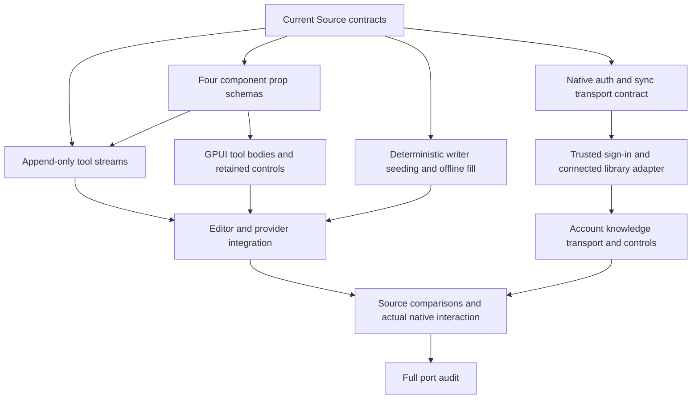

# Connected and generated UI work

The full hosted desktop remains the reference. The running preview is the
immutable offline build; this wave must preserve its library and leave its
window open. Existing web, Convex and configuration edits are protected.

| Node | Ownership | Deliverable and gate |
| --- | --- | --- |
| P | Sakana fugu-max; proposed `src/gen_ui/props.rs` only | Source Zod-compatible validation, Unicode and numeric edge cases; Root compares with the unchanged Source oracle |
| T | Sakana fugu-max; proposed `src/gen_ui/stream.rs` only | Original cumulative JSONL append contract; uses the fixed P API; no writer-field rewrites or invented recovery behavior |
| A | Sakana fugu-max; bounded contract JSON only | Actual auth/sync names, wire fields, missing trust and concrete adapter boundary; no account or registration action |
| V | Root; new native tool view | Original four components, labels, local working state and Source-derived styling |
| E | Sakana fugu-max proposal; Root adoption | Original sentence spans, seeds and no-provider branches compared with the unchanged Source oracle |
| I | Root; shared exports, editor and provider coordinators | Actual accepted requests and retained UI; stale folio/range/revision checks; meaningful undo and failure behavior |
| C/K | Root, after A | Trusted native sign-in, account-scoped sync/conflicts and knowledge sources/tool review; foundations alone do not enable capability |
| Q | Root; Cargo and runtime ownership | Focused checks, Source/native interaction and render comparisons; real providers/account proof remain separate |

Workers return proposals without executing tools or changing files. Root reviews
and adopts each proposal in a separate directory before production edits.
Disjoint input bundles and their SHA256 pins are retained under
`target/verification/sakana-genui-inputs`. Root owns manifests, barrels,
`app.rs`, `main.rs`, every runtime and the user preview. No worker may revert
or overwrite another participant's work.

Wave one runs P/T/A in parallel after the P function signature is fixed.
Root works on V while they run. Integration follows review and Source checks;
rendered/runtime checks follow a successful build. This graph does not claim
that AI, account sync, knowledge sources or generated UI are complete.

P/T/E now have integrated native/Source contract comparisons. V has compiled
tool bodies, retained controls and typed requests; its actual editor mounting,
Source/native geometry and interaction gates remain open. I/C/K remain
implementation work. The user's preview uses its existing immutable binary.
