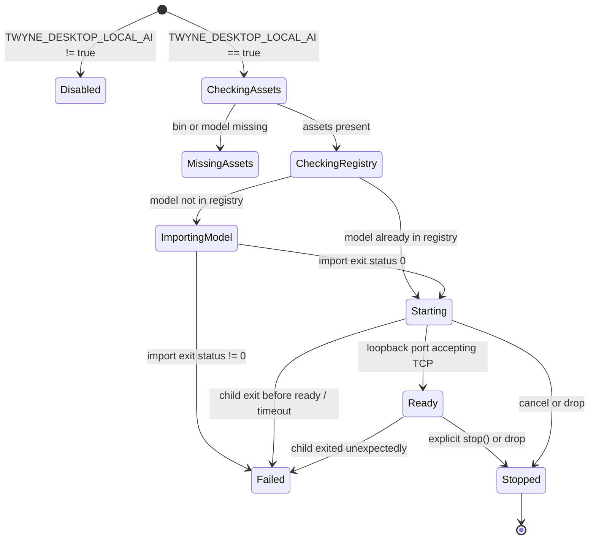

# Native AI Request/Runtime Adapter Foundation & Managed Local LiteRT Lifecycle

**Requirement Reference**: `desktop/gpui/PORT_PLAN.md` Requirement #24  
**Authoritative Source Implementations**:
- `desktop/litert-server.ts`
- `desktop/main.ts`
- `src/utils/ai-client.ts`
- `src/utils/desktop-bridge.ts`
- `src/utils/generation-stream.ts`
- `src/utils/reasoning-tags.ts`
- `src/utils/interview-stream.ts`
- `src/utils/llm-parsing.ts`
- `src/utils/research-targets.ts`
- `src/utils/background-research.ts`
- `src/utils/live-review.ts`

---

## 1. Managed Local LiteRT-LM Server Lifecycle

### 1.1 Environment & Defaults Contract
The local model server is governed by the following environment variables:
| Environment Variable | Source Default | Description |
|---|---|---|
| `TWYNE_DESKTOP_LOCAL_AI` | unset (disabled) | `"true"` or `"1"` activates local LiteRT management. |
| `LITERT_LM_BIN` | `./bin/litert-lm` | Path to the LiteRT-LM CLI binary. |
| `LOCAL_MODEL_PATH` | `./models/MiniCPM5-2B_int4.litertlm` | Path to the bundled MiniCPM5 LiteRT weights. |
| `LOCAL_MODEL_ID` | `minicpm5-2b` | Stable model identifier registered in LiteRT. |
| `LOCAL_PROVIDER_ID` | `desktop-litert-local` | Stable provider identifier registered in settings. |
| `LITERT_LM_STARTUP_TIMEOUT_MS` | `20000` (20s) | Maximum deadline before readiness abort. |
| `STARTUP_POLL_MS` | `150` (150ms) | Loop interval checking TCP connectivity. |

### 1.2 State Machine
The lifecycle follows a strictly bounded, non-blocking state machine:

### 1.3 Child Process Invariants
- **Port Allocation**: Dynamically allocates a free TCP port by binding loopback `127.0.0.1:0`.
- **Registry Inspection**: Executes `litert-lm list` with a bounded stdout reader (capped at 256 KiB) to check for `minicpm5-2b`.
- **Graceful Termination**: The `LiteRtServerHandle` implements `Drop` to ensure any spawned child process is terminated on drop or exit. No orphan or zombie processes leak into the OS.

---

## 2. Native AI Request & Runtime Adapter

### 2.1 Provider Configurations & Credentials Security
- **Server-Held Credentials**: API keys and authorization tokens are strictly encapsulated within the native runtime coordinator (`AiProviderConfig.api_key`).
- **No Token in UI**: Serialized records sent to UI or views omit API keys (`#[serde(skip_serializing_if = "Option::is_none")]`), preventing credential exfiltration.
- **Provider Resolution**: Matches Source `resolveFeatureConfig` and `resolveFeatureConfigForPersona`:
  - Voice-only providers (`fishaudio`, `supertonic`) are constrained to voice features (`voice-narration`, `voice-transcription`).
  - Text and language features (`rubric-review`, `persona-analysis`, `research-extract`, etc.) route to language models.
  - Per-feature overrides in settings take precedence, falling back to global default provider.

### 2.2 Keystroke & Manuscript Revision Isolation
- Whole-document AI jobs (such as Rubric reviews, synthesis, or background research) are tied to a `RevisionIdentity { folio_id, generation }`.
- When an AI response arrives, the coordinator validates if the manuscript generation has advanced during the request. Stale outputs are safely rejected rather than stomping live edits.
- Whole-document scans are kept away from per-keystroke typing paths.

### 2.3 Streaming Accumulator & Reasoning Tags
- Implements `GenerationStreamAccumulator` matching `generation-stream.ts`.
- Text and reasoning channels have independent lifecycles (`active_part`: `Reasoning` | `Text` | `None`).
- Mid-stream reasoning tag withholding: trailing tag prefixes such as `<th`, `<think`, or `</thin` are held back via `trim_partial_reasoning_tag` to prevent visual flicker before the tag completes.
- Handles self-closing malformed closers (`<think/>`) and unclosed trailing blocks.
- Interview contract markers (`DOSSIER:`, `PROBE:`, `SYNTHESIZE:`) are withheld from visible chat bubbles.

### 2.4 Loopback Transport (OpenAI-Compatible /v1)
- Zero external dependencies: communicates with `127.0.0.1:<port>/v1/chat/completions` using Rust's standard library `std::net::TcpStream`.
- Supports both non-streaming completions and streaming Server-Sent Events (`data: {...}`).
- Thread-safe `CancellationToken` enables immediate socket closure when the user switches folios or cancels an operation.
- Bounded line lengths (`MAX_SSE_LINE_BYTES = 64 KiB`) and bounded response bytes (`MAX_RESPONSE_BYTES = 8 MiB`).
